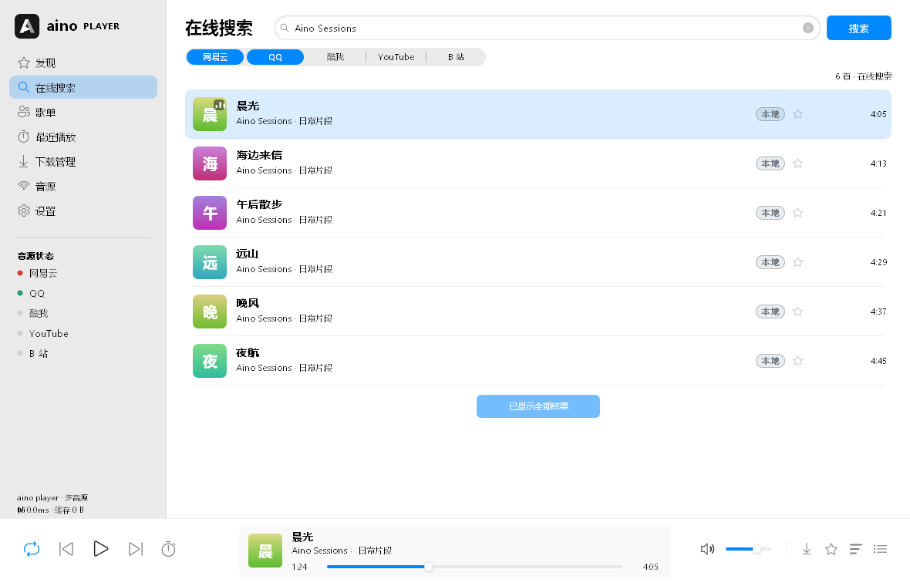
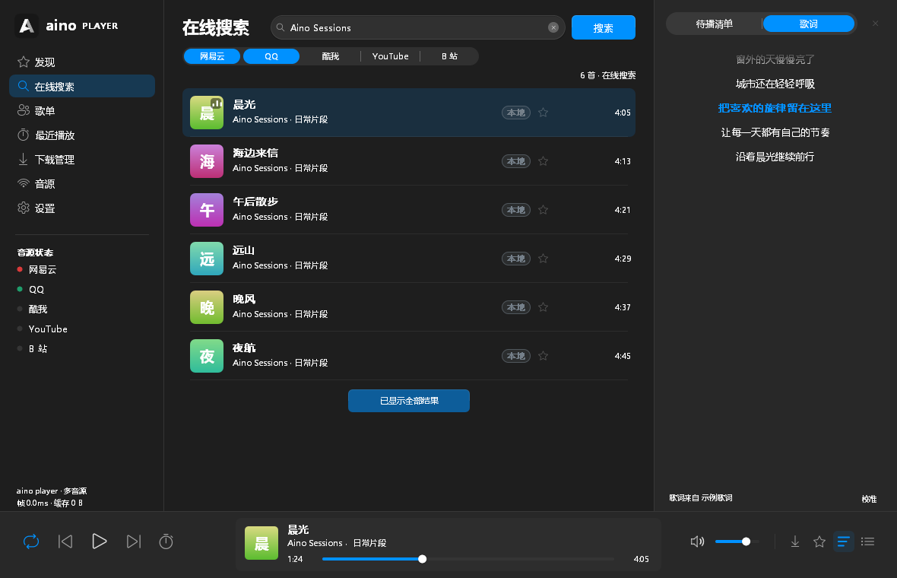

<p align="center">
  
</p>
<h1 align="center">Aino Player</h1>
<p align="center">极简界面，多源音乐。Windows · Linux</p>
<p align="center">
  <a href="https://github.com/sudoevolve/aino-player/releases/latest">下载最新版</a> ·
  <a href="docs/RELEASE_NOTES.md">更新内容</a> ·
  <a href="https://github.com/sudoevolve/aino-player/issues">反馈问题</a>
</p>




*界面展示使用示例曲目，不代表平台推荐内容。*

## 能做什么

- **发现与搜索**：网易云、QQ 音乐、B 站、酷我；YouTube Music 实验支持。
- **播放与浏览**：内置精简 FFmpeg，支持 AAC / M4A；歌手、专辑与 B 站分 P，队列、循环、定时关闭和同步歌词。
- **自己的资料库**：导入音乐文件夹、本地收藏、保存在线歌单，支持筛选、排序及备份恢复。
- **桌面播放**：系统托盘、媒体键、系统媒体控制和音频输出设备选择，Windows / Linux 均可用。
- **登录与升级**：外部官网登录，无需扩展；应用内查看 GitHub 更新说明、下载并安装新版本。

## 下载与安装

在 [GitHub Releases](https://github.com/sudoevolve/aino-player/releases/latest) 下载：

| 系统                             | 推荐下载                                         |
| -------------------------------- | ------------------------------------------------ |
| Windows x64                      | `setup-windows-x64.exe` 安装器；也提供便携 EXE |
| Ubuntu 22.04+ / Debian 12+ amd64 | `.deb` 安装包                                  |

Linux 推荐添加一次 [APT 软件源](docs/APT.md)，之后直接安装和更新：

```bash
sudo apt install aino-player
```

也可下载 deb 直接安装。设置 → 通用 → 版本更新可查看更新内容；升级保留配置、收藏和歌单。

## 使用提示

- 官网登录自动回传支持 Chrome / Edge / Chromium；平台会员和地区限制照常生效。
- Linux 使用 X11 / XWayland，建议安装 `fonts-noto-cjk`；应用内安装更新需要 `pkexec`，托盘需要桌面提供支持。
- 设置 → 数据可查看存储位置、清理缓存和登录信息、导出或恢复资料库。

## 开发与许可

[构建指南](docs/BUILDING.md) · [架构与验证记录](docs/ADR-001-portable-player.md) · [Linux 内存实测](docs/Linux-memory-profile.md) · [第三方依赖](vendor/README.md)

Apache-2.0 · 作者 [sudoevolve](https://github.com/sudoevolve) · [aino UI 库](https://github.com/sudoevolve/aino)
