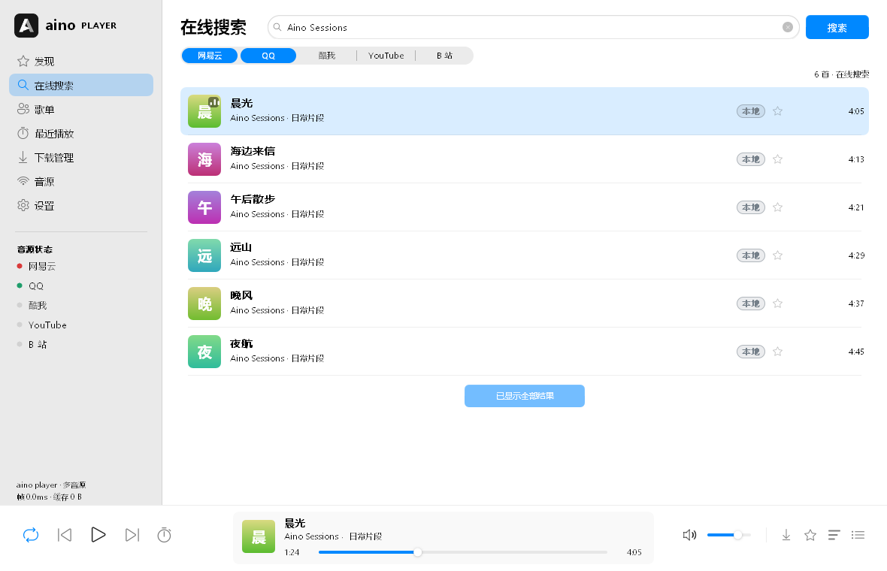
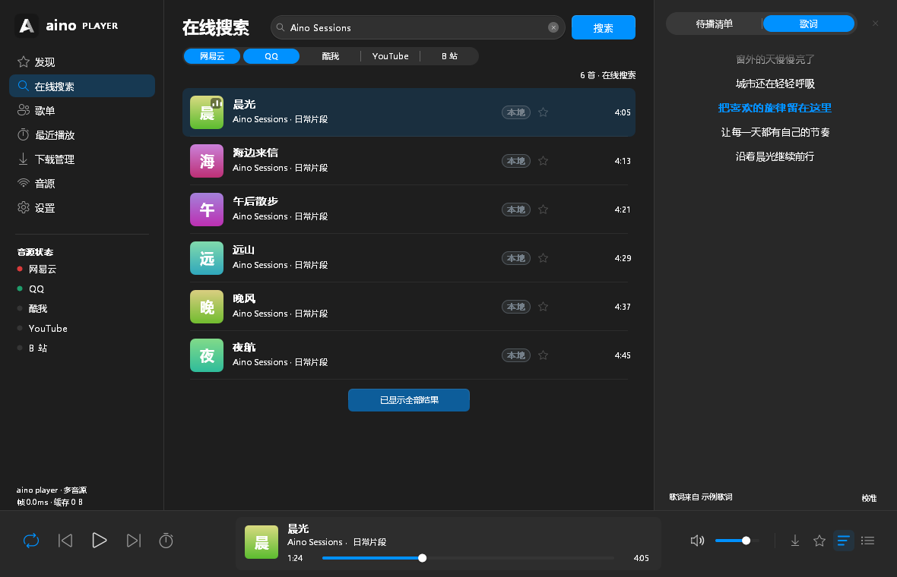

<p align="center">
  
</p>
<h1 align="center">Aino Player</h1>
<p align="center">极简界面，多源音乐。Windows · Linux</p>
<p align="center">
  <a href="https://sudoevolve.github.io/aino-player/">项目主页</a> ·
  <a href="https://github.com/sudoevolve/aino-player/releases/latest">下载最新版</a> ·
  <a href="docs/RELEASE_NOTES.md">更新内容</a> ·
  <a href="https://github.com/sudoevolve/aino-player/issues">反馈问题</a>
</p>




*界面展示使用示例曲目，不代表平台推荐内容。*

## 能做什么

- **发现与搜索**：网易云、QQ、酷我、酷狗、咪咕；B 站支持搜索与分 P；五个平台均可搜索在线歌单，热门歌单支持继续加载。
- **两条取流渠道**：第三方音源脚本（`sources/*.js`，免登录）与自带接口（`providers/*.js` + 内置，可登录），在「音源」页分开管理。
- **第三方音源**：兼容部分 LX 脚本 API（内嵌 QuickJS），网易云 / QQ / 酷我 / 酷狗 / 咪咕分别显示状态，可单独检测脚本；启动静默测速一轮，智能切换优先选同平台可用且快的源，关闭后按检测结果选定一个固定源，不因单曲失败自动换源。
- **脚本可更新**：平台搜索与发现统一在 `providers/*.js`，默认内嵌；第三方取流脚本可导入、在线获取或重新加载。详见[支持范围](providers/README.md)。
- **播放与浏览**：内置精简 FFmpeg，支持 AAC / M4A；歌手、专辑与 B 站分 P，队列、循环、定时关闭、无缝衔接、可选实时响度均衡、十段均衡器，以及同步歌词和中文译文；区分现场、翻唱、伴奏等版本，歌词可手动匹配并记住。
- **悬浮歌词**：单双行、字号、宽度、透明度、置顶、译文和锁定穿透；支持自定义已唱／未唱／背景颜色，按行时间推进填色。可拖入 Windows 任务栏或 Ubuntu Xorg 顶栏停靠，拖出恢复悬浮。可在歌词侧栏快捷开关，在「设置 → 通用 → 悬浮歌词」配置。
- **自己的资料库**：导入音乐文件夹、本地收藏、保存在线歌单，支持筛选、排序、限量撤销和自动轮换备份，恢复前可预览并选择内容；歌曲单击选择、Ctrl 增减、Shift 连选，双击或点击封面播放；支持批量收藏、加入队列、下载、添加到指定／新建歌单与移除。
- **离线与连续播放**：完整下载自动关联原曲、优先本地播放；下载记录重启保留，支持时间／大小排序、文件重新定位，可播放、加入队列或保存歌单。下一曲仅预读有界首段，支持可选短淡入淡出和定时淡出。
- **桌面播放**：系统托盘、媒体键、系统媒体控制、输出设备选择；可设置设备变化与休眠暂停。`Ctrl+K` 快速查找、`Ctrl+F` 歌单内筛选、`Ctrl+Z` 撤销，在「设置 → 快捷键」或按 F1 配置快捷键；Windows / Linux X11 支持自定义全局组合键，Wayland 沿用桌面媒体控制。
- **登录与升级**：外部官网登录，无需扩展；应用内查看 GitHub 更新说明；Windows 安装版覆盖升级、便携版下载 EXE 后手动替换；Linux 根据安装方式提供包管理器更新命令或对应安装包。

## 下载与安装

在 [GitHub Releases](https://github.com/sudoevolve/aino-player/releases/latest) 下载：

| 系统                             | 推荐下载                                         |
| -------------------------------- | ------------------------------------------------ |
| Windows x64                      | `setup-windows-x64.exe` 安装器；也提供便携 EXE |
| Ubuntu 22.04+ / Debian 12+ amd64 | `.deb` 安装包                                  |
| Fedora 44+ x86_64（DNF）         | `.rpm` 安装包或 [RPM 软件源](docs/RPM.md) |
| Arch x86_64                      | `.pkg.tar.zst` 安装包或 [Arch 软件源](docs/ARCH.md) |

Linux 一键安装（amd64 / x86_64）：

```bash
# Ubuntu 22.04+ / Debian 12+
curl -fsSL https://sudoevolve.github.io/aino-player/install.sh | bash

# Fedora 44+（DNF）
curl -fsSL https://sudoevolve.github.io/aino-player/install-rpm.sh | bash

# Arch Linux / 衍生发行版
curl -fsSL https://sudoevolve.github.io/aino-player/install-arch.sh | bash
```

自动添加签名软件源（[APT](docs/APT.md) / [RPM](docs/RPM.md) / [Arch](docs/ARCH.md)）并安装；之后交给系统包管理器更新。Arch 安装会执行完整的 `pacman -Syu`，避免局部升级。升级保留配置、收藏和歌单。

官网或下载页仍显示旧版本时，可按 `Ctrl+F5` 强制刷新。GitHub Pages 的浏览器／CDN 缓存可能短暂保留旧页面；最新正式版本以 [GitHub Releases](https://github.com/sudoevolve/aino-player/releases/latest) 为准。

## 使用提示

- 音源导入后保存在用户配置目录，重启自动后台加载；“移除”保留 JS，重新导入可恢复。
- 本地音乐：在「歌单 → 本地」点击「打开音乐」，或按 `Ctrl+O` 多选文件；也可拖入文件 / 文件夹。自动播放第一首并加入队列，重复文件不会重复添加，队列可保存为本地歌单。
- 默认播放器：在「设置 → 通用 → 本地播放」设置文件关联；Windows 还需在弹出的系统设置中确认。支持系统双击 / 打开方式，已有播放器运行时会优先交给现有窗口。
- 官网登录自动回传支持 Chrome / Edge / Chromium；平台会员和地区限制照常生效。
- Linux 使用 X11 / XWayland，建议安装 `fonts-noto-cjk`；便携版安装 deb 需要 `pkexec`，托盘需要桌面提供支持。
- 设置 → 数据可查看存储位置、清理缓存和登录信息、导出或选择性恢复资料库、查看自动备份与缺失文件、手动重试失败封面。
- 在线更新：在「设置 → 通用 → 检查更新」查看。Windows 安装版校验安装包后覆盖升级，便携版下载 EXE 后需退出并替换原文件；Linux 系统安装可复制包管理器命令，未配置软件源或同步滞后时可直接下载对应包。下载期间可取消，系统安装开始后请等待完成。

## 开发与许可

[构建指南](docs/BUILDING.md) · [架构与验证记录](docs/ADR-001-portable-player.md) · [Linux 内存实测](docs/Linux-memory-profile.md) · [第三方依赖](vendor/README.md)

Apache-2.0 · 作者 [sudoevolve](https://github.com/sudoevolve) · [aino UI 库](https://github.com/sudoevolve/aino)
